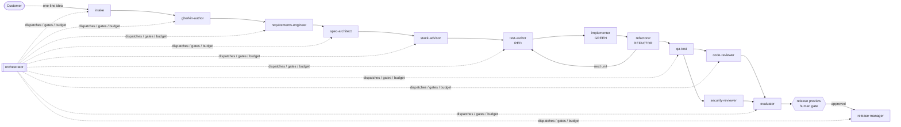

# SDD Agent Harness

**A multi-agent harness that turns a one-line product idea into tested, reviewed, released software — through a gated, spec-driven pipeline of specialised AI roles.**

Instead of asking one AI assistant to "just write the code", the harness splits software delivery into stages (intake → BDD scenarios → requirements → specification → architecture → TDD → review → evaluation → release). Each stage is owned by a dedicated sub-agent with a narrow responsibility, explicit inputs and an output contract. Agents never chat with each other: they collaborate through files on a shared *blackboard*, and a deterministic engine decides when the line may advance.

Built on native [Claude Code](https://docs.claude.com/en/docs/claude-code/overview) mechanisms (sub-agents, skills, slash commands, hooks, `CLAUDE.md`), with a small dependency-free Python engine for the parts that should not be left to a model.

---

## Why

Letting a single agent write code end to end is fast, but it tends to drift from the intent, skip tests and approve its own work. This harness applies ordinary software-engineering discipline to agents:

| Problem with "vibe coding" | How the harness addresses it |
|---|---|
| The AI drifts away from what was actually wanted | Every stage produces **human-readable artifacts** (Gherkin, numbered requirements, specs) and must pass a **gate** before the next stage |
| Quality depends on luck | Mandatory **TDD** (separate RED / GREEN / REFACTOR roles) plus **independent QA, code-review and security-review** roles |
| Long sessions pollute the context | Each stage runs in its **own sub-agent** with only the files it needs |
| Nobody can tell why a decision was made | The orchestrator writes an **activity log** of every decision and its reason |
| Unattended runs can burn unlimited tokens | **Step budget, per-run caps, turn limits** and a mandatory **human release gate** |
| Changes later on mean starting over | A **traceability chain** (FR ⇄ scenario ⇄ SPEC ⇄ test) enables impact analysis and scoped re-runs in **change mode** |

## How it works



### Key design decisions

- **Blackboard protocol.** All state lives in the product folder: `sdd-state.json` (single source of truth for stage, gates, mode and budget), the stage artifacts, and `activity-log.md`. Every role reads only what it needs, writes back its output, and logs what it did. This keeps contexts small and makes every run resumable.
- **Separation of powers.** The role that decides to advance (orchestrator), the roles that judge quality (qa-test, reviewers, evaluator) and the roles that produce work are never the same — no agent approves its own output.
- **Autonomous, but bounded.** The line runs without interruption by default and stops only when a safety condition fires (ambiguous requirements, repeatedly failing tests, a review blocker, budget exceeded) or at the single mandatory human gate before release.
- **Declarative pipeline.** Stages, roles, inputs, outputs and gates are declared in [`framework/pipeline/pipeline.yaml`](framework/pipeline/pipeline.yaml); changing the process means editing one file.
- **Deterministic engine, creative agents.** Advancing, gating, budgeting and resuming are plain Python ([`framework/engine/`](framework/engine/)) with unit tests; the AI only does the work inside a stage, through a pluggable driver.
- **Soft rules made hard.** Claude Code hooks ([`framework/hooks/`](framework/hooks/)) enforce what prompts can only ask for: a skill/stage check before every action, lint/type checks after every edit, and a guard against destructive shell commands. All hooks fail open.
- **Pluggable stacks.** Requirements and specs are stack-agnostic; from stage 5 on, a stack profile ([`framework/stacks/`](framework/stacks/)) defines layout, test tooling, coverage thresholds and build commands — including an offline fallback learned from a real run.

## Repository layout

```
.
├── CLAUDE.md              # global rules every agent follows (blackboard, autonomy, separation of powers)
├── .claude/               # Claude Code wiring: hooks in settings.json; agents/skills/commands link to framework/
├── framework/             # the reusable core ("the factory")
│   ├── pipeline/          #   pipeline.yaml — stages, roles, gates, modes
│   ├── agents/            #   14 sub-agent role definitions
│   ├── skills/            #   methods: requirement intake, BDD/Gherkin, spec authoring, TDD loop, change management
│   ├── commands/          #   /build and /sdd-* slash commands
│   ├── engine/            #   deterministic runner: state machine, gates, budget, resume, drivers
│   ├── hooks/             #   guard layer (Claude Code hooks)
│   ├── stacks/            #   tech-stack profiles (python, web-ts, template)
│   ├── templates/         #   artifact templates for every stage
│   ├── prompts/           #   reusable prompt library
│   └── gates/             #   Definition of Done and quality gates
├── products/              # products built with the framework ("the output")
│   ├── _template/         #   skeleton for new products
│   └── todo-cli/          #   sample: full artifact chain of one pipeline run
└── references/            # decision records and lessons learned
```

## Quick start

Requirements: Python 3.10+ and, for the agent workflow, [Claude Code](https://docs.claude.com/en/docs/claude-code/overview).

**Run the whole pipeline inside Claude Code**

```text
claude                                  # open Claude Code at the repository root
/build a command-line habit tracker     # one shot: intake → … → release preview
/sdd-status habit-tracker               # progress board at any time
```

Or stage by stage: `/sdd-new` → `/sdd-bdd` → `/sdd-spec` → `/sdd-implement` → `/sdd-review` → `/sdd-release`.

**Drive the state machine with the engine**

```bash
PYTHONPATH=framework python3 -m engine new habit-tracker --desc "a command-line habit tracker"
PYTHONPATH=framework python3 -m engine run habit-tracker        # advances until a stage needs work, a gate, or the budget
PYTHONPATH=framework python3 -m engine status habit-tracker
PYTHONPATH=framework python3 -m engine run habit-tracker --approve-release   # after previewing
```

**Run the tests**

```bash
PYTHONPATH=framework python3 -m unittest engine.tests.test_engine            # engine: 6 tests
cd products/todo-cli && PYTHONPATH=src python3 -m unittest discover -s tests  # sample product: 31 tests
```

## Sample product: `todo-cli`

[`products/todo-cli/`](products/todo-cli/) is the first end-to-end validation run and shows the complete artifact chain: [discovery](products/todo-cli/discovery.md) → [Gherkin features](products/todo-cli/features/) → [11 FRs + 5 NFRs with a traceability matrix](products/todo-cli/requirements.md) → [spec volumes](products/todo-cli/spec/) → [architecture with ADRs](products/todo-cli/architecture.md) → TDD implementation (31 tests, 92% coverage, standard library only) → [review report](products/todo-cli/review-report.md) → [release notes](products/todo-cli/release-notes.md).

The product is deliberately small: its purpose is to exercise the pipeline, not the product. The run also fed a lesson back into the framework (an offline test fallback, see [`references/decisions/`](references/decisions/)).

## Status and roadmap

This is a personal project and a work in progress. Being explicit about what is and is not done:

- ✅ Pipeline, roles, skills, commands, templates, hooks and gates — usable today inside Claude Code
- ✅ Deterministic engine (state machine, gates, budget, resume, activity log) with offline tests
- ✅ One full greenfield run (`todo-cli`) driven stage by stage in interactive Claude Code sessions
- 🔄 **Unattended execution.** The `claude` driver (Claude Agent SDK) is implemented but not yet exercised end to end; a driver that runs Claude Code headless (`claude -p`) is planned as a budget-friendly alternative
- 🔄 **Benchmarking framework changes.** Re-running the same product spec after each change to roles/skills and comparing tests passed, coverage, review findings, human interventions and turns used
- 🔄 **Standardised stack scaffolds** generated by official starters (e.g. `uv init`, `create-vite`) to reduce variance between runs
- 🔜 **A more representative product** built with the harness: a multi-agent investment-research assistant (LangGraph, a custom MCP server over market data, RAG over company filings)

## Author

Yan Sang — [LinkedIn](https://www.linkedin.com/in/yan-sang/)

## License

[MIT](LICENSE)
